<picture><source media="(prefers-color-scheme: dark)" srcset="assets/hero-dark.svg"></picture>

<picture><source media="(prefers-color-scheme: dark)" srcset="assets/about-dark.svg"></picture>

<picture><source media="(prefers-color-scheme: dark)" srcset="assets/projects-heading-dark.svg"></picture>

<picture><source media="(prefers-color-scheme: dark)" srcset="assets/ecosystem-dark.svg"></picture>

<a href="https://github.com/gr33nimax/HYDRA-ULTIMATE"><picture><source media="(prefers-color-scheme: dark)" srcset="assets/project-hydra-ultimate-dark.svg"></picture></a>&nbsp;<a href="https://github.com/gr33nimax/hydrabox"><picture><source media="(prefers-color-scheme: dark)" srcset="assets/project-hydrabox-dark.svg"></picture></a>

<a href="https://github.com/gr33nimax/hydracore"><picture><source media="(prefers-color-scheme: dark)" srcset="assets/project-hydracore-dark.svg"></picture></a>&nbsp;<a href="https://github.com/gr33nimax/HYDRA-ULTIMATE#readme"><picture><source media="(prefers-color-scheme: dark)" srcset="assets/documentation-dark.svg"></picture></a>

<picture><source media="(prefers-color-scheme: dark)" srcset="assets/stack-dark.svg"></picture>

<picture><source media="(prefers-color-scheme: dark)" srcset="assets/activity-heading-dark.svg"></picture>

<picture><source media="(prefers-color-scheme: dark)" srcset="assets/stats-dark.svg"></picture>

<picture><source media="(prefers-color-scheme: dark)" srcset="assets/streak-dark.svg"></picture>

<a href="https://t.me/hydraucb"><picture><source media="(prefers-color-scheme: dark)" srcset="assets/community-dark.svg"></picture></a>

<a href="https://github.com/gr33nimax/hydrabox/releases"><picture><source media="(prefers-color-scheme: dark)" srcset="assets/button-1-dark.svg"></picture></a>&nbsp;&nbsp;<a href="https://github.com/gr33nimax/HYDRA-ULTIMATE#readme"><picture><source media="(prefers-color-scheme: dark)" srcset="assets/button-2-dark.svg"></picture></a>

<a href="https://metawka.github.io/expressive-profile/?from=gr33nimax"><picture><source media="(prefers-color-scheme: dark)" srcset="assets/credit-dark.svg"></picture></a>

